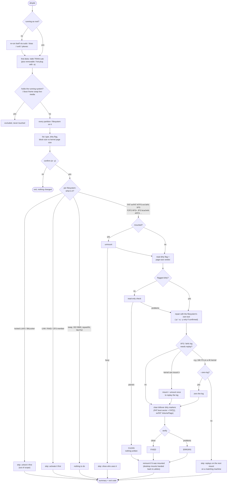
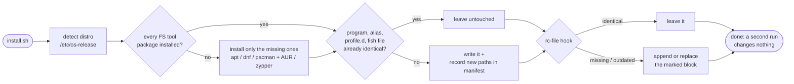

# dirtybit

**Find every removable USB drive, fsck whatever filesystem is on it, and clear its "dirty" bit.**

You pulled a stick without ejecting it, and now Windows wants to "scan and fix", macOS mounts it read-only, or Linux logs `Volume was not properly unmounted`. Type `dirtybit`. It finds the USB drives, works out each filesystem, unmounts it, checks it read-only with the correct tool, repairs it and clears the dirty markers only if something is actually wrong, and mounts it again where it was.

It is **idempotent**: a healthy drive is never written to, so running `dirtybit` twice in a row changes nothing the second time. The installer is idempotent too.

```
$ dirtybit
dirtybit 1.0.0 — kernel 7.3.4-300.fc45.x86_64 · x86_64 · page size 4096

Found 2 filesystem(s):
  [1] /dev/sda1          exfat     28.7GiB    "exfatUSB" USB SanDisk 3.2Gen1 [usb]
      state: DIRTY (VolumeDirty flag) · mounted at /run/media/user/exfatUSB
  [2] /dev/sdb2          btrfs     58.2GiB    "asahi-data" Samsung Flash Drive [usb]
      state: clean (CoW — no dirty bit; log tree empty) · block 16384/page 4096: no
      this kernel's btrfs only mounts sectorsize 4096

  ? Check/repair these 2 filesystem(s)? Mounted ones are unmounted first and remounted after. [y/N]
```

Free and open source software.

---

## Install

```bash
git clone https://github.com/doug445/dirtybit.git && cd dirtybit
sudo ./install.sh
```

| Distro | Detected as | Package manager |
|---|---|---|
| Linux Mint 21/22, LMDE, Ubuntu, Debian | `linuxmint`, `ubuntu`, `debian` | apt |
| Fedora, **Fedora Asahi Remix** (Apple Silicon) | `fedora`, `fedora-asahi-remix` | dnf / dnf5 |
| Arch Linux, **Asahi ALARM** (Arch Linux ARM) | `arch`, `archarm` | pacman + paru/yay for AUR |
| openSUSE Tumbleweed / Leap / Slowroll | `opensuse-*` | zypper |

The installer does the following:

1. **Installs every missing filesystem tool** so that every filesystem below can be checked. Packages already installed are skipped. Packages a release doesn't carry are reported, not treated as errors. On Arch, AUR-only tools (`hfsprogs`, `apfsprogs-git`) go through your `paru` or `yay`, running as you; pass `--no-aur` to skip that. On image-based systems (Silverblue, Aeon, MicroOS) it prints the `rpm-ostree` or `transactional-update` command for you to run instead.
2. Installs the program as `/usr/local/bin/usb-dirtybit`.
3. Sets up the **`dirtybit` alias** for bash, zsh and fish (`/etc/profile.d/dirtybit.sh`, plus a marked hook in the system `bashrc`/`zshrc` where needed, and `/etc/fish/conf.d/dirtybit.fish`). It also adds a `/usr/local/bin/dirtybit` symlink, so `sudo dirtybit`, scripts and cron work too.
4. Prints a support table: which checkers are present and which filesystems this kernel can mount.

Re-running the installer is safe and changes nothing that's already in place. If no tool is missing, it doesn't touch the package manager or the network. Unchanged files aren't rewritten. The shell hook is replaced, never added a second time. `--uninstall` removes exactly what was added, using a manifest of the files and directories the installer created, and puts every edited rc file back byte for byte. Running `--uninstall` a second time does nothing.

Other modes:

```bash
sudo ./install.sh --no-deps     # program + alias only
./install.sh --check            # just the support table
sudo ./install.sh --uninstall   # remove program + alias (packages stay)
```

`dirtybit` elevates itself through `sudo`, `doas`, `run0` or `pkexec`, so run it as your normal user.

---

## Usage

```
dirtybit                 scan all USB drives, confirm once, fix everything
dirtybit -l              list USB filesystems and their dirty state, change nothing
dirtybit -n              dry run: read-only checks (mounted ones are skipped)
dirtybit -y              no prompts (unmount, repair, escalate automatically)
dirtybit -d /dev/sdc     only this disk/partition (repeatable)
dirtybit -i disk.img     check an image file (no root needed for your own files)
dirtybit -a              also include non-USB removable media (built-in SD readers…)
dirtybit --zero-log      XFS/btrfs: discard a log this kernel can't replay (see below)
dirtybit --repair        btrfs: allow `btrfs check --repair` (last resort)
dirtybit --no-remount    leave everything unmounted afterwards (e.g. before unplugging)
```

Exit status: `0` everything clean or fixed · `1` errors remain · `2` bad usage · `3` no USB filesystems found · `4` something was skipped (missing tool, busy, locked, or can't be handled on this kernel).

Every run is logged to `/var/log/dirtybit.log`.

### Safety

- **The disk holding the running system is never touched.** That covers `/`, `/boot`, `/boot/efi`, `/usr`, `/var`, `/home`, swap, and live-USB media under `/run/initramfs/live`, `/run/live/medium` or `/run/archiso`. They are excluded even if they sit on USB, and `-d` refuses them.
- Filesystems are only checked **while unmounted**. dirtybit unmounts them (and lists what is using a busy drive), then remounts them afterwards. Desktop mounts under `/run/media/$USER` or `/media/$USER` are handed back to udisks as you, so they show up in your file manager again. Anything else is remounted with its original options.
- **Read-only first.** Every filesystem gets a read-only check (`-n`, `--readonly` or `--dry-run`). It is written to only if that check fails or its dirty flag is set. Clean drives are left byte-identical.
- Repairs start in each tool's safe automatic mode (`-p`, `-a`). If a stronger repair (`-y`) is needed, you're asked first unless you passed `-y`.
- FAT, exFAT, NTFS, HFS+ and btrfs get a second read-only pass after a repair to verify it. The other tools are trusted on their exit status.
- `-n` never writes anything.
- **Encrypted volumes are out of scope.** dirtybit never unlocks LUKS or BitLocker. Unlock the volume yourself, from your file manager or with `udisksctl unlock -b /dev/sdX1`, and dirtybit finds and checks the filesystem inside. Locked volumes are listed and skipped.

---

## How it works



The installer follows the same rule: do nothing when nothing needs doing.



---

## Filesystems

In every row the read-only pass comes first. The repair command shown only runs when that pass fails or the dirty flag is set.

| FS | Dirty marker that's read and cleared | Checker used | Notes |
|---|---|---|---|
| **FAT12/16/32** (vfat) | Boot-sector state bit (Linux) **and** FAT[1] clean-shutdown + hard-error bits (Windows), in every FAT copy | `fsck.fat -n` → `-a -w` → `-n` to verify | Windows' "scan and fix" prompt reads FAT[1], which `fsck.fat` doesn't reset, so dirtybit resets it itself |
| **exFAT** | `VolumeFlags.VolumeDirty` (boot sector offset 106) | `fsck.exfat -n` → `-p` (`-y` on request) → `-n` | The `MediaFailure` flag is reported but left alone: it records real bad sectors |
| **NTFS** | `$Volume` `VOLUME_IS_DIRTY` | `ntfsfix -n` → `ntfsfix -d` | Detects hibernated / Fast-Startup volumes and tells you to shut Windows down fully. `ntfsfix` isn't `chkdsk`; for serious damage use Windows |
| **ext2/3/4** | Superblock state ≠ clean, `needs_recovery` | `e2fsck -f -n` → `-f -p` (`-f -y` on request) | The journal is replayed in userspace, whatever the block size |
| **btrfs** | No dirty bit (copy-on-write). A pending fsync **log tree** is the nearest equivalent | `btrfs check --readonly`; log replayed by mounting once | `--repair` only on explicit request. Multi-device filesystems are scanned first |
| **XFS** | Dirty log (`xfs_repair` exit 2) | `xfs_repair -n` → replay by mounting once → `xfs_repair` | `-L` (zero the log) only with `--zero-log` |
| **F2FS** | Checkpoint without the `UMOUNT` flag | `fsck.f2fs -f --dry-run` → `-f -y` | See the 16K section below |
| **HFS+ / HFS** | `kHFSVolumeUnmountedBit` clear, or inconsistent bit set | `fsck.hfsplus -f -n` → `-f -y` | Journaled HFS+ is supported |
| **JFS** | Superblock `s_state` (`FM_MOUNT`, `FM_DIRTY`, `FM_LOGREDO`) | `fsck.jfs -n` → `-f -p` | |
| **bcachefs** | (checker decides) | `bcachefs fsck -n` → `-p` (`-y` on request) | Out of mainline since 6.18 (DKMS) |
| **APFS** | (check only) | `fsck.apfs` / `apfsck` | apfsprogs can't repair. Use macOS Disk Utility |
| **EROFS** | Read-only | `fsck.erofs` (verify only) | |
| **ReiserFS** | (checker decides) | `reiserfsck --check` → `--fix-fixable` | Removed from Linux 6.13. Copy the data off |
| **UDF** | LVID integrity open/closed | `udfinfo` (report only) | No Linux fsck exists. Windows `chkdsk` can repair UDF |
| **NILFS2, ISO 9660, squashfs** | none | — | Log-structured or read-only, so there's nothing to clear |
| **LUKS, BitLocker** | — | not unlocked: out of scope | Unlock it yourself (file manager, `udisksctl unlock`) and the filesystem inside is checked like any other. Locked volumes are skipped |
| LVM, mdraid, ZFS members | — | skipped | Activate them, then `dirtybit -d /dev/<inner>` |

---

## 16K / 64K page-size filesystems (Apple Silicon / aarch64)

Asahi Linux (Fedora Asahi Remix, ALARM, Ubuntu Asahi) runs **16K-page** kernels. Some other aarch64 kernels use 64K pages, for example RHEL's `kernel-64k`. Several Linux filesystems record a block size taken from the page size of the kernel that formatted them. So a USB drive formatted on a Mac running Asahi can carry a filesystem that an ordinary 4K-page x86 kernel can't mount, and the reverse can happen too.

dirtybit reads each filesystem's block size and compares it with this kernel's page size (`getconf PAGESIZE`), then reports one of: **mountable here**, **may not mount**, or **NOT mountable on this kernel**.

| FS | Typical aarch64 case | Can this kernel mount it? |
|---|---|---|
| **btrfs** | `sectorsize 16384`: btrfs-progs older than 6.7 defaulted to the page size, so older Asahi installs have 16K sectors | Read from `/sys/fs/btrfs/features/supported_sectorsizes`. x86 typically lists `4096` only. A 4K btrfs mounts fine on 16K kernels |
| **F2FS** | **Block size equals the page size of the kernel that formatted it, so it's 16K on Asahi** | Only when block size = page size. A 16K F2FS won't mount on 4K x86, and a 4K F2FS is flagged as "may not mount" on 16K kernels. **`fsck.f2fs` needs f2fs-tools ≥ 1.17** to read a 16K F2FS at all. Older tools have 4K blocks compiled in, so dirtybit skips the volume and says so (exit 4) rather than mis-reading it |
| **XFS** | `-b size=16384` or `65536` | Block size > page size is supported from kernel 6.12 |
| **ext4** | `-b 16384` or `65536` | Supported where the kernel exposes `/sys/fs/ext4/features/blocksize_gt_pagesize` (recent kernels) |
| JFS | rare | Block size ≤ page size |
| FAT, exFAT, NTFS, HFS+ | cluster size doesn't depend on page size | Always |

**The key point: fsck is userspace and doesn't care about page size.** `e2fsck`, `btrfs check`, `xfs_repair` and (with f2fs-tools ≥ 1.17) `fsck.f2fs` all check a 16K filesystem fine on a 4K x86 machine, and the reverse. Page size only matters when the kernel has to **mount** the filesystem. dirtybit mounts for two reasons:

- **To replay a dirty XFS log or btrfs log tree.** If this kernel can't mount the filesystem, dirtybit says so and leaves the log alone. The log replays the next time the drive is mounted on a matching machine. Pass `--zero-log` only if you accept losing the last few seconds of writes.
- **To remount the drive afterwards.** If that fails, you're told to replug it on the right machine.

To format USB drives that work on both sides, use `mkfs.btrfs -s 4096`, `mkfs.xfs -b size=4096` and `mkfs.ext4 -b 4096`, or simply exFAT.

---

## Testing without real hardware

```bash
tests/make-test-images.sh /tmp/dbt           # FAT16/32, exFAT, NTFS, ext4, JFS, HFS+ marked dirty;
                                             # 16K btrfs / 16K XFS / 16K ext4, F2FS, EROFS, locked LUKS
./usb-dirtybit -l /tmp/dbt/*.img             # show detected state + page-size verdicts
./usb-dirtybit -y /tmp/dbt/*.img             # repair them all (no root needed)

tests/idempotency-test.sh                    # run 1 repairs; run 2 must find nothing and
                                             # leave every image byte-identical
tests/container-test.sh mint arch suse fedora   # installer in podman: install twice (2nd = no-op),
                                             # uninstall twice (state == before install)
```

---

## Files

| Path | What |
|---|---|
| `/usr/local/bin/usb-dirtybit` | the program |
| `/usr/local/bin/dirtybit` | symlink to it |
| `/etc/profile.d/dirtybit.sh` | `alias dirtybit=…` |
| `/etc/{bash.bashrc,bash.bashrc.local,zshrc,zsh/zshrc}` | marked `# >>> dirtybit alias >>>` hook, only where the distro doesn't already source profile.d |
| `/etc/fish/conf.d/dirtybit.fish` | fish alias |
| `/var/lib/dirtybit/install-manifest` | paths the installer created, so uninstall removes exactly those |
| `/var/log/dirtybit.log` | run log (kept on uninstall) |

## License

MIT
